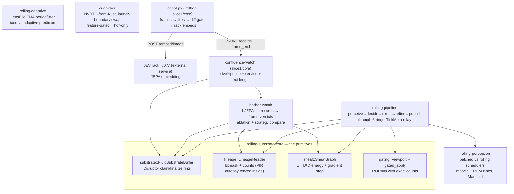

# ARCHITECTURE — the engine book

The low-level engine of rolling-perception / Confluence, documented
against the code as it stands today. Every structural claim below was
checked against the tree (sources read, `cargo tree` run,
`cargo test --workspace` run: **107 passed, 0 failed** on the dev VM
(recounted per-package at the phase-2 assembly; earlier editions of
this book said 55, 75, 90, 95 in turn — each predated the lanes that
followed it; trust the current README arithmetic),
2026-11-01). Where the founding documents (`PLAN.md`, `DESIGN.md`)
and the code disagree, this book sides with the code and says so —
§4 collects the divergences.

Companions: `docs/READING-GUIDE.md` (the whole repo),
`docs/RESULTS.md` (the numbers ledger), `PLAN.md` / `DESIGN.md`
(the founding record — graded and designed *before* the build, and
therefore partly a historical document; see §4).

---

## 1. The map

Seven Rust components. **Zero external crates** — every workspace
dependency is a path dependency inside this repo (verified:
`cargo tree` shows no registry crates at all).

The dependency edges, exactly as `cargo tree` prints them:

- `confluence-watch` → `harbor-watch`, `rolling-substrate-core`
- `harbor-watch` → `rolling-substrate-core`
- `rolling-pipeline` → `rolling-perception`, `rolling-substrate-core`
- `rolling-perception`, `rolling-substrate-core`, `rolling-adaptive`,
  `cuda-thor` → *(no workspace dependencies)*

| component | owns | explicitly does NOT own |
|---|---|---|
| `rolling-substrate-core` (`crates/rolling-substrate-core/src/`: `substrate.rs`, `lineage.rs`, `sheaf.rs`, `gating.rs`) | The ring protocol, lineage recording, Laplacian energy/step, ROI gating with counted skips | Scheduling, payload meaning, any GPU/FFI, drop policies (see §4), consumer-side delivery guarantees beyond `is_published` polling |
| `rolling-perception` (`src/lib.rs`, `src/main.rs`) | The scheduling claim itself: two scheduler functions over identical lanes/work; TTFU / inter-output metrics; the PCM demux lane | Rings (its lanes call each other directly), lineage, sheaf, real sensors (readiness is modelled with `sleep`, labelled at every call site) |
| `rolling-pipeline` (`src/lib.rs`, `src/bin/`, `tests/pipeline_e2e.rs`) | The integrated cascade: 6 substrate rings, stage functions, the `Director` (deadband policy), `Ops` counters, the rolling-trace v1 text format + replay | Concurrency (it drives the rings strictly sequentially, single-threaded). (An earlier edition also disclaimed gate staleness marking here — built in the proof sweep, see P5.) |
| `rolling-adaptive` (`src/lib.rs`, `src/main.rs`) | `LensFile` (EMA period/jitter/phase-error, text-serialisable), ground-truth trace generation, causal predictors, the executor simulation | Any dependency on the sibling crates (deliberately standalone), wall-clock timing (logical µs throughout) |
| `cuda-thor` (`src/lib.rs` CPU reference, `src/gpu.rs` FFI, `tests/spikes.rs`) | PLAN §6 spikes **1 and 3**: NVRTC `compute_110` compile/load/launch from Rust; launch-boundary module swap with epoch retirement (`Swapper`) | Spike 2 (launch vs shadow vs persistent lives in `experiments/thor-cuda/` + `results/thor/2026-11-01-spike2.md`, not in this crate), any always-on GPU residency |
| `harbor-watch` (`src/`: `record.rs`, `pipeline.rs`, `fixture.rs`, `ablation.rs`, `rng.rs`) | The batch cascade over real embedding records: cosine decide, top-k direct, one Laplacian refine, fresh-only publish; the fixture + ground truth; raw-vs-refined ablation and ALL-vs-CHANGED compare | Acquisition and embedding (the driver's job), gating by focus (direct publishes the focus set; it does not gate compute in this version) |
| `confluence-watch` (`slice1/core/src/`: `live.rs`, `service.rs`, `ledger.rs`, `config.rs`; `ingest/ingest.py`) | The live form: frame-at-a-time cascade (`LivePipeline`, parity-tested vs batch), ingest process management, JEV-rack lifecycle (start iff down, stop iff started), the per-stream text ledger (lens/state/events/health) | Frame acquisition/tiling/embedding (owned by `ingest.py`), the console and any serving (Slice 1/2 siblings) |

**Data that flows between them**

- *Inside the substrate*: slot payloads are `Box<[f32]>` behind a
  lease; lineage rides **in the slot** (`LineageHeader`), cleared at
  each re-lease.
- *Pipeline*: payload data moves ring→ring only. Control state
  (decide's signal summary + the lineage relay) moves in `TickMeta`,
  alongside the rings and labelled as control, not data — because
  slot headers are cleared on re-lease, lineage accumulates across
  edges only via the `LineageSnapshot` capture/replay in `TickMeta`.
- *Harbor-watch*: input records are JSONL
  `{seq, frame, tile, t_arrival_us, diff_score, embedding[1280]}`;
  embeddings ride the rings untruncated (ingest ring dim = 1280,
  decide ring dim = 1281: score + embedding).
- *Confluence-watch*: `ingest.py` emits the same record schema plus
  `frame_end` lines on stdout; the service assembles frames, runs
  `LivePipeline`, and writes the ledger as structured text files.

---

## 2. Claim → proof tracing — PLAN.md

Status key: **proven** (a test or a committed measured record pins
it) · **partial** (the mechanism is proven in a weaker or narrower
form than the claim states) · **UNPROVEN** (nothing in the tree pins
it). Locations are `file::module` in the staging tree.

| # | claim (PLAN §) | implemented in | proof | status |
|---|---|---|---|---|
| P1 | Rolling beats batched on TTFU + inter-update interval for identical work (§1.2, §5.1 S1) | `rolling-perception/src/lib.rs::run_rolling/run_batched`; `rolling-pipeline/src/lib.rs::run` | tests `rolling_first_output_beats_batched_and_emits_more`, `both_schedulers_do_the_same_work`, e2e `schedulers_same_work_rolling_emits_more_and_first`; bench records `results/thor/`, Thor exp1 | **proven** |
| P2 | All four scenarios benched, incl. rolling-hostile S2 (heavy slices), S3 (global consumer), S4 (single lane) (§5.1) | — | no scenario suite exists; only the staggered-friendly regime is tested (plus zero-stagger demo runs) | **UNPROVEN** |
| P3 | Staleness-at-query-time is a measured metric (§1.2.3) | — | no crate computes a query-time age metric; snapshots carry ticks, ages are never derived | **UNPROVEN** |
| P4 | Gating savings are counted ops, exact (§5.2) | `rolling-substrate-core/src/gating.rs::gated_apply`; `rolling-pipeline/src/lib.rs::Ops` | `skipped_counts_are_exact`; e2e exact accounting (96 gated of 192 baseline) | **proven** |
| P5 | Gating contract: inside-gate identical, outside untouched *and marked stale-by-gate with last-computed tick* (§5.2) | `gating.rs`; pipeline `Published` now carries `stale_by_gate` + `last_computed_tick` (§5 naming), stamped from each tick's gate | `tests/stale_marking.rs` (cell-by-cell) | **PROVEN** (2026-11-01 night, proof sweep; was partial) |
| P6 | Sheaf: E ≥ 0, non-increasing per step, → consensus, as *property tests on random connected graphs* (§5.3) | `rolling-substrate-core/src/sheaf.rs::SheafGraph` | deterministic tests on line/ring graphs (`energy_strictly_decreases_on_inconsistent_input`, `smoothing_preserves_mean_on_ring`); harbor-watch `sheaf_energy_never_increases`; pipeline asserts per payload at runtime | **partial** — mechanism proven; the mandated random-graph property form is absent (no proptest anywhere in the tree) |
| P7 | Disconnected graph: consensus per component, not across (§5.3) | `sheaf.rs` (structurally true: energy is a sum over edges) | no test constructs a disconnected graph | **UNPROVEN** |
| P8 | Disagreement injection: corrupt one section, energy rises by a computable amount, step reduces it (§5.3) | — | no dedicated test; nearest is fixed inconsistent inputs in `sheaf.rs` tests | **UNPROVEN** |
| P9 | Counted lineage matches a reference log exactly, saturation *flagged* (§5.4) | `rolling-substrate-core/src/lineage.rs::LineageHeader` | unit tests (exact counts, 10,000 visits, no false positives) | **partial** — counts cover only the first 16 nodes (`counts: [u32; 16]`, presence covers 64); saturation at `u32::MAX` is silent — **no overflow flag exists**; no random-sequence property test |
| P10 | PIR autopsy demonstrates all three failure modes (§5.4) | `lineage.rs::pir_legacy` | `overflow_creates_false_positive` ✓, `pir_loses_order` ✓ | **partial** — count-blindness (1 vs 5 visits) is argued in the module docs but has no test |
| P11 | Ring delivers exactly-once, in-order; 8 slots / 100,000 messages; loom-modelled (§5.5) | `rolling-substrate-core/src/substrate.rs::FluidSubstrateBuffer` | `multi_producer_claims_are_unique_and_all_publish` (4 threads × 50 claims, cap 8, real threads) | **partial** — claim uniqueness + publication proven at 200 claims; consumer-side in-order exactly-once *delivery*, the 100k stress, and the loom model do not exist |
| P12 | Drop-oldest / drop-newest policies with accounted loss (§5.0, §5.5) | — | `lease()` spins until the slot frees: the built ring is block-only; no drop counters exist | **UNPROVEN** (not implemented) |
| P13 | Deterministic replay: same trace ⇒ bit-identical snapshot sequence, both schedulers (§5.0, §5.5) | `rolling-pipeline/src/lib.rs::parse_trace/load_trace`; `rolling-adaptive::gen_trace` | `tests/replay_determinism.rs` (24 snapshots, every field bit-identical; both schedulers) | **PROVEN** (proof sweep — writing the assertion first caught the trace writer's `{:.6}` formatting destroying float bits in 384/384 values; the writer now emits round-trip floats, same v1 grammar) |
| P14 | Acceptance hygiene: clippy clean in CI; banned patterns grep-enforced (§5.6, §8.2) | `.github/workflows/ci.yml` | CI config runs fmt + `clippy --workspace --all-targets -D warnings` + tests on x86_64/aarch64 | **partial** — clippy leg exists (the workflow's own header notes it was prepared, enablement is Casey's); **no grep gate** for banned patterns and no loom job exist in CI |
| P15 | Spike 1: NVRTC `compute_110` from Rust matches CPU reference (§6) | `cuda-thor/src/gpu.rs::spike1` | ignored Thor test `spike1_nvrtc_compute110_matches_cpu_reference`; record `results/thor/2026-11-01-spike1-3.txt` (observed bit-exact; stated tol 1e-5) | **proven** (on the Thor; GPU tests are `#[ignore]`d + feature-gated and run nowhere else) |
| P16 | Spike 2: launch-bound vs two-stream shadow vs persistent, measured (§6) | `experiments/thor-cuda/exp1–exp4*`, `spike2/` | `results/thor/2026-11-01-spike2.md` (shadow = recommended default; persistent loses 9–27× for slice work; priorities no effect) | **proven** as an experiment — but it lives outside the `cuda-thor` crate the plan specced as its home |
| P17 | Spike 3: 1,000 launch-boundary swaps, epoch retirement, no leak (§6) | `cuda-thor/src/gpu.rs::spike3`, `Swapper` | ignored Thor test `spike3_thousand_swaps_epoch_retirement_no_leak` (structural: loads == unloads == 1000, every epoch verified; memory gate −384 MiB set by measured pool noise) | **proven** (same Thor-only caveat as P15) |
| P18 | The seed's "<100 ns persistent-warp pickup" (§3 row 7: drop the numbers, measure) | `experiments/thor-cuda/exp3_persistent.cu` | measured instead: 4.8 µs mean request→ack (exp3), launch pickup p50 1.1 µs (spike 2) | **refuted by measurement** — the seed number is ~50× off; the plan's scepticism was the correct call |

## 3. Claim → proof tracing — DESIGN.md

DESIGN.md was written before the build and the build diverged from
it in load-bearing places. This table is the honest reconciliation.

| # | claim (DESIGN §) | what the code actually is | proof / gap | status |
|---|---|---|---|---|
| D1 | Ring protocol is **SPSC per lane**: per-slot sequence states, consumer acquire/release (§3.2, INV-R1–R3) | **Multi-producer Disruptor claim/finalize**: producers `fetch_add` a global claim, spin for the slot's lap, publish with `sequence = claim + capacity` (Release); consumers *poll* `is_published` and read via `unsafe read_published` — there is no consumer protocol object (`substrate.rs`) | `multi_producer_claims_are_unique_and_all_publish` proves the built protocol's claim safety; round 2 then built the §3.2 protocol as `SpscRing` and pinned it (`tests/spsc_properties.rs`) | **RESOLVED by Amendment A (2026-11-01)**: as first written this row read "§3.2 does not describe the shipped ring; DESIGN.md was never updated". Both halves have since been fixed by measurement, not editing alone: the designed SPSC ring exists and out-benchmarks the Disruptor (D12), and DESIGN §3.2 now describes both rings and their placements |
| D2 | `SlotHeader` is exactly one 64-byte cache line with the specified field layout; full `Lineage` rides at the payload head behind a `lineage_version` (§3.1, §5) | `Slot` is `#[repr(align(64))]`, size a multiple of 64 (asserted); lineage lives **inside the slot** as an atomics-based `LineageHeader`; payload is a `Box<[f32]>` field of the slot | `slots_are_64_byte_aligned_and_padded` pins alignment/size only | **partial** |
| D3 | Conservation: `produced == consumed + dropped + in_flight`, asserted at shutdown (INV-R4, §3.4) | No such accounting exists anywhere in the ring | — | **UNPROVEN** |
| D4 | Backpressure policies Block / DropNewest / DropOldest chosen per ring (§3.4) | Block-by-spin only in the Disruptor (see P12); `SpscRing` implements all three policies per the amended §3.4 (DropNewest via the gap signal — the original text was unimplementable, RING-BENCH A1) | `tests/spsc_properties.rs` (policy tests vs a naive model) | **PARTIAL — proven for SpscRing; the Disruptor remains Block-only by design placement (Amendment A)** |
| D5 | INV-S1: energy ≥ 0 for all s | Structural (sum of squared edge differences, computed in f64) + fixed-point/zero-energy tests | `consistent_input_has_zero_energy_and_is_fixed_point`, `clamp_counterexample_is_caught` | **proven** (for the scalar-section form built; see D8) |
| D6 | INV-S2: a valid-α step never increases energy | Proven on the built graphs; pipeline re-asserts it per payload at runtime (`stage_refine` panics on an increase) | sheaf tests + harbor `sheaf_energy_never_increases` | **proven** |
| D7 | INV-S3: the averaging form preserves the per-component mean; docs must not claim it for the gradient form | The built step *is* the gradient form — and on the ring graph it preserves the mean anyway (1ᵀL = 0), which the test pins | `smoothing_preserves_mean_on_ring` | **proven**, with the note that the invariant holds for a reason DESIGN assigns to the other form |
| D8 | Sections are f32 blocks with per-edge overlap coordinate sets; incidence applied via CSR (§4) | Built form is narrower: **one f64 scalar per graph node**, edge list (not CSR), whole-"section" differences only | sheaf.rs module docs state this scope honestly | **partial** — the consensus special case, exactly as PLAN §5.3 scoped it; DESIGN §4's richer structure was not built |
| D9 | INV-S4: NaN in a section ⇒ energy NaN *and the step refuses* with `SheafError::NonFinite` (§4, F6) | `try_smooth_step(_into)` refuse with `SheafError::NonFinite` before any mutation; the legacy signature delegates (refusal = panic) so harbor-watch/slice1 inherit it; probe had shown NaN spreading to neighbours and α=NaN returning plausible finite energies | `d9_*` tests (5: refusal leaves the section bitwise unchanged; mid-run poisoning refused) | **PROVEN** (proof sweep) |
| D10 | α validated at construction, `0 < α ≤ 2/λmax` via power-iteration `spectral_bound`; out-of-range α is an error (§4) | `spectral_bound()` (power iteration, 100 iters, recorded), `alpha_bound()`, `validate_alpha` (never clamps), `Smoother::new` validates at construction; the probe's α=10 divergence (energy 54 → 53,214) is now refused | `d10_*` tests (boundaries pinned at ±1e-9 on ring(8), λmax=4 exact) | **PROVEN** (proof sweep; caveat recorded: the estimate converges from below, near-degenerate spectra get a slightly generous bound; live call sites sit ≥2.5× inside) |
| D11 | The sheaf step allocates nothing (pre-allocated scratch) (§4) | `laplacian_apply_into` + counting-allocator test (0 allocations steady-state, bitwise parity with the legacy path) | `sheaf.rs`, `tests/sheaf_alloc.rs` | **PROVEN** (2026-11-01 night, SHEAF-FIX: was "contradicted by the code" in this book's first edition; the legacy signature delegates to the into-path; DESIGN §4 now carries an Amendment A note pointing at this proof, so §4's text stands unamended) |
| D12 | DESIGN §3.2's SPSC ring is the engine's queue centre (§3.2) | `SpscRing` built as written; head-to-head in docs/RING-BENCH.md: SPSC faster (6.7–11.4 vs 2.6–5.6 M msgs/s) **and the shipped Disruptor, consumed as a queue, tore 5–27% of reads silently in every run** (no consumer release/counters) | `spsc.rs`, `tests/spsc_properties.rs`, RING-BENCH.md | **PROVEN as amended** (2026-11-01, DESIGN Amendment A — drafted from the RING-BENCH measurement, Casey's approval on record): DESIGN §3.2/§3.4 now state the measured placement — SPSC takes per-lane cascade queues (backpressure + INV-R4 accounting); the Disruptor keeps multi-producer junctions + latest-value points; the shipped ring used as a paced queue is REFUTED and must not survive — with the original §3.2/§3.4 text preserved in DESIGN.md as superseded history, and §3.4's DropNewest corrected per ambiguity A1 (gap signal + consumer release-on-skip). Design and code now describe the same system |
| D13 | A GPU executor can fill the pipeline's executor seam (connect round) | cuda-thor's public API cannot compile/load/launch any kernel but the hardcoded `perceive` (5 named gaps, gpu.rs); the executor refuses typed (`GpuApiGap`) and Thor-verified the refusal on real hardware; CPU bar measured (0.268 µs @ 64 nodes) + launch pickup 1.1 µs ⇒ GPU refine cannot win below ~4,096 nodes regardless | `rolling-pipeline` README (Composition), executor.rs | **UNPROVEN — blocked on specified cuda-thor API additions; low-stakes at current scales by measurement** |
| D12 | INV-G1/G2: gated output inside == ungated; outside never modified (§7.4) | `gating.rs::gated_apply` | `gated_result_identical_on_roi_and_untouched_outside` (also asserts `f` is never *called* outside) | **proven** |
| D13 | INV-D2: gate churn bounded by deadband (**band + yaw**: challenger must win for `yaw_ticks` consecutive ticks) (§6, §7.4) | `Director` implements the band (deadband + max-step) but **no yaw counter** — it moves on the first out-of-band tick; churn is counted (moves/holds) but no oscillating-input churn test exists | `director_deadband_holds_and_steps` (band half) | **partial** |
| D14 | INV-M1: the harness *rejects* a comparison whose counted work differs (§7.2, §7.4) | Tests assert equality of checksum and of the whole `Ops` struct across schedulers; no test feeds a rigged node and asserts refusal | e2e `schedulers_same_work_rolling_emits_more_and_first` | **partial** |
| D15 | INV-D1: logical-clock determinism, type-level (deterministic APIs take `LogicalClock` only) (§7.3, F8) | No `Clock`/`LogicalClock` types exist; determinism is achieved by seeded LCG/SplitMix generators and logical-µs arithmetic in `rolling-adaptive` | kernel/trace determinism tests across crates | **partial** — the property holds; the type-level mechanism was never built |
| D16 | F3: publish only after the full chain succeeds; a failed generation is counted `aborted` (§8) | Structurally true in the pipeline (finalize happens after stage work; a panic unwinds before publish) but there is no `aborted` counter and no panic-injection test | — | **partial** |
| D17 | F9: non-power-of-two capacity is a construction error (§8) | `FluidSubstrateBuffer::new` asserts | `capacity_must_be_power_of_two` (should-panic) | **proven** |

**Tally: 34 claims traced — 10 proven, 13 partial, 10 unproven,
1 refuted by measurement (P18, a seed claim the plan was right to
doubt).** The single worst divergence is **D1**: the design
document's central protocol description (SPSC, §3.2) is not the
protocol in the code. Anyone reasoning about the ring from
DESIGN.md alone will reason about the wrong system; the correct
protocol description lives in `crates/rolling-substrate-core/src/substrate.rs`.

---

## 4. Invariants ledger (per crate)

Each invariant the crate's correctness rests on, and the test that
pins it — or **GAP** where nothing does.

### rolling-substrate-core
- Capacity is a power of two; slot index = `claim & mask`
  (`substrate.rs`). Pinned: `capacity_must_be_power_of_two`,
  `ring_wraps_and_reuses_slots`.
- Claims are unique: one `fetch_add` hands each claim to exactly one
  producer. Pinned: `multi_producer_claims_are_unique_and_all_publish`.
- A lease's exclusivity rests on the lap protocol (spin-Acquire on
  `sequence == claim`; publish = Release-store of `claim + capacity`).
  Pinned behaviourally by `lease_write_finalize_read_back` +
  the multi-producer test. **GAP: no loom model** (PLAN §5.5 required
  one); the happens-before argument exists only as comments + the
  `unsafe impl Sync` justification in `substrate.rs`.
- Lineage is cleared when a slot is re-leased. Pinned:
  `lineage_is_cleared_on_reuse`.
- Counts saturate, never wrap (`counts: [u32; 16]`, CAS loop stops at
  `u32::MAX`). **GAP: no saturation test** (the largest test count is
  10,000) and no overflow flag (see P9).
- Sheaf energy is a sum of squares (≥ 0) and strictly decreases on
  inconsistent input at α = 0.1. Pinned on fixed graphs. **GAP: no
  random-graph property test; no α validation (D10); no NaN refusal
  (D9).**
- Gating: `processed + skipped == width × height`, always. Pinned:
  `skipped_counts_are_exact`, `full_viewport_skips_nothing_empty_skips_everything`.

### rolling-perception
- Both schedulers perform identical work: checksum equality.
  Pinned: `both_schedulers_do_the_same_work` (Δ < 1e-6; bench prints
  Δ = 0.000000, checksum 345101.1999 on x86_64 and aarch64).
- Kernels are deterministic (LCG inputs, no wall-clock in the math).
  Pinned: `kernel_is_deterministic`.
- `sleep` appears only as modelled sensor readiness, never as
  compute. **GAP: pinned by convention and code review only — CI has
  no grep gate (P14).**

### rolling-pipeline
- Rings advance in lockstep, one claim per tick per edge.
  Enforced by `debug_assert_eq!` in `handoff` — **GAP: checked in
  debug builds only**; release builds rely on the sequential driver.
- Published lineage = all five stages exactly once (mask `0b11111`).
  Pinned: e2e `end_to_end_lineage_energy_and_gating`.
- Refine never increases energy — asserted **at runtime, per
  payload**, inside `stage_refine` (stronger than a test: a violation
  panics the run). Test-side: the same e2e asserts after < before.
- The gate direct sets on tick N is the gate perceive uses on tick
  N+1. Pinned: `gate_feedback_lands_on_next_pass`.
- Counted ops are identical under both schedulers. Pinned: e2e
  `assert_eq!(b.ops, r.ops)` + exact gating accounting (96/192).

### rolling-adaptive
- Predictors are causal: the prediction for arrival k uses only
  arrivals < k. True by construction in `predict_adaptive`
  (lens observes after predicting). **GAP: no adversarial test**
  (e.g. permuting future arrivals and asserting predictions don't
  change).
- Fixed predictor is *exact* on a perfect sensor — the tie condition.
  Pinned: `fixed_is_exact_on_a_perfect_sensor`. (Adaptive also
  converges to exactness there — its period estimate adopts the true
  interval — but the *tie* itself is asserted only via the scenario-C
  bench row in the crate README, not by a dedicated test.)
- Lens estimates converge to ground truth (period ±100 µs at
  σ = 300 µs; drift tracked within 5%). Pinned:
  `lens_converges_to_ground_truth_without_drift`, `lens_tracks_slow_drift`.
- Lens text round-trips. Pinned: `lens_text_roundtrip`.

### cuda-thor
- A module is unloaded only after its epoch event has synchronised,
  and swaps happen only between launches. Structural in
  `gpu.rs::Swapper` (unload is reachable only through
  `retire_oldest`). Pinned on the Thor by the ignored spike-3 test.
  **GAP: on any non-Thor machine zero GPU tests execute** — the
  invariant is untestable in ordinary CI by design, and the Thor run
  record is the only evidence.
- GPU output matches the CPU reference within stated TOL (1e-5).
  Pinned on the Thor (spike 1; observed bit-exact). CPU-reference
  determinism pinned everywhere: 3 lib tests.

### harbor-watch
- A verdict is a claim about *this* frame: a tile publishes
  `changed` only if it has a fresh record this frame **and** its
  smoothed score ≥ threshold; stale tiles publish `stable`, labelled
  `stale`. Pinned: `changed_strategy_file_stale_tiles_and_compare`,
  `cut_detected_at_the_cut_frame_not_before_not_after`.
- Sub-threshold drift is never flagged (raw or refined). Pinned:
  `gradual_drift_is_not_flagged_as_a_cut`.
- Embeddings are carried at full dimension (ingest 1280, decide
  1281). Pinned: `full_1280_dimension_is_carried_not_truncated`.
- Refine energy never increases across a run. Pinned:
  `sheaf_energy_never_increases`.
- Records survive JSONL round-trip within stated tolerances.
  Pinned: `jsonl_round_trip`.

### confluence-watch (slice1/core)
- Live ≡ batch: `LivePipeline` produces verdict-identical output to
  `harbor_watch::pipeline` on the fixture — changed flags, stale
  flags, lineage masks equal; scores within 1e-9. Pinned:
  `live_matches_batch_on_fixture`.
- The ledger is complete per frame: lens/state/events/health all
  written; published verdicts carry `lineage_mask: 31` and
  `verdict_latency_ms`. Pinned: `ledger_files_and_lineage`.
- Rack ownership: the service stops the rack on exit **iff it
  started it**. Pinned for the not-started path:
  `service_end_to_end_via_ingest_interface` asserts
  `rack_started_by_me == false` with a stub rack. **GAP: the
  started-by-me path is covered only by the on-Thor acceptance run
  (`slice1/core/acceptance.sh`), not by a unit test.**

---

## 5. Where the founding docs no longer describe the code

Read `PLAN.md` for the grading and the acceptance logic — it holds
up well. Read `DESIGN.md` for the *reasoning* (the seed-protocol
autopsy in its §3.3 is still the best explanation of why the ring
looks the way it does), but **do not read it as a description of
the built system** in these places:

1. **The ring protocol (DESIGN §3.2)**: *resolved by Amendment A.*
   SPSC was designed; a multi-producer Disruptor claim ring was
   built first (D1). Round 2 built the designed SPSC ring, benched
   the two head-to-head (D12, RING-BENCH.md), and §3.2 now
   describes both rings and their placements, with the original
   text preserved as superseded history.
2. **The module layout (DESIGN §1)**: one crate with 14 modules was
   designed; a 7-member workspace was built. `clock.rs`, `slot.rs`,
   `ring.rs`, `node.rs`, `workloads.rs`, `scheduler.rs`,
   `metrics.rs`, `replay.rs` do not exist as files; their concerns
   live inside `rolling-perception` (schedulers/metrics),
   `rolling-pipeline` (stages/trace), and `rolling-substrate-core`
   (ring/lineage/sheaf/gate). `pir.rs` exists as
   `lineage.rs::pir_legacy`, as designed.
3. **Types (DESIGN §2)**: `LaneId`/`NodeId`/`Seq`/`Tick`/`Stamp` do
   not exist as types; node ids are bare `usize` stage constants,
   sequences are the ring's claim counters, ticks are `u64` fields.
   Nothing enforces the registry discipline DESIGN specifies
   (P9/D2).
4. **Backpressure & conservation (DESIGN §3.4)**: designed in full,
   built as block-only spin with no accounting (D3/D4).
   *Partially resolved by Amendment A*: `SpscRing` carries all
   three policies and INV-R4 accounting; §3.4's amended text
   records that its original DropNewest was unimplementable as
   written. The Disruptor remains Block-only, by placement.

None of these divergences is hidden in the code — the crate docs
describe what was actually built, usually well. The remaining
debt is items 2–3 above (layout and types), still unamended
because no measurement has yet forced the question.
